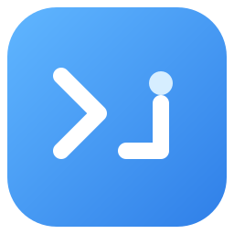

# Codex Proxy

[English](README.en.md) · [Releases](https://github.com/tangboys/CodexProxy/releases) · [构建](docs/BUILDING.md) · [验证记录](TEST-RESULTS.md)

给 Windows x64 上的 Codex 桌面版提供独立代理的 C# / WPF 工具。支持多订阅单选、节点预选与测速、套餐用量、实时流量和中英文界面。

这是社区工具，与 OpenAI、v2rayN、Mihomo 或 Clash Verge Rev 没有官方隶属关系。Codex 桌面版需自行从官方渠道安装，本项目不提供 Codex、账号或代理订阅。

## 获取

当前版本 **0.10.0 预览版**从 [Releases](https://github.com/tangboys/CodexProxy/releases) 获取。下载 `CodexProxy.exe` 即可运行，.NET 运行时和 Mihomo 已内置；许可证、第三方通知与对应源码在同一 Release 和仓库中提供。预览版尚未完成运行验证。

本版不提供产品 ZIP 或安装包。自行构建会生成 `dist/0.10.0/CodexProxy.exe`，见[构建说明](docs/BUILDING.md)。后续如提供便携包，推荐使用完整的 `CodexProxy-<version>-win-x64.zip`；再分发时请同时保留许可和对应源码材料。GitHub 源码下载不是可运行程序。

## 快速开始

1. 完全退出旧 Codex Proxy，再打开 `CodexProxy.exe`。默认正式代理停止，不自动启动 Codex；关闭窗口会收起到托盘，完全退出使用“退出程序”。
2. 在“订阅设置”新增名称和 HTTP(S) 链接。“保存”存为备用，“保存并启用”选为当前订阅；一次只启用一个，不合并节点。可直接编辑或隐藏已保存链接。
3. 停止时仍可查看缓存节点、最后状态/延迟和检测时间，预选节点或自动模式。预选允许未检测或上次不可用节点，不代表节点已经可用。
4. 使用“检测节点”或“刷新节点”后点击“启动代理”。停止时检测/导入使用短时隔离内核，结束后仍停止；正式代理启动后应用保存的选择。“检测 Codex”当前仍要求正式代理已启动。
5. **最后验证真实 Codex**：保存工作并完全退出已有 Codex 桌面实例，再点击“启动 Codex”，发送一条消息确认真实登录和模型请求。路径会自动检测，也可手选桌面 EXE；已有实例或节点检测失败会提示。

“停止代理”结束本工具拥有的正式内核，保留 Codex 和本地转发桥，便于按原端口重新启动；已开始的流式请求可能需要重试。“退出程序”会清理自有内核与桥接，仍保留 Codex。不会结束其他代理软件的进程。

## 节点、套餐和本地流量

- 节点快照按订阅 URL 隔离持久保存。停止时可浏览和预选，普通测速会更新延迟与检测时间；国旗由节点名称推断，不保证真实地理位置。
- 多内核设置支持内置 **Mihomo v1.19.31** 或已安装的兼容 Mihomo。应用内核时停止状态保持停止；运行时切换可能短暂断连。Clash GUI、Xray 和 sing-box 不是可直接替换的 Mihomo。
- 套餐来自订阅服务商响应头。可停止刷新，显示已用/总量、剩余、到期和进度；请求失败保留同 URL 上次缓存并提示，成功但未提供有效字段显示未知。未知或 0 总量不表示无限。
- “刷新用量”只读取套餐，不更新节点；“刷新节点”处理节点后另行读取套餐。套餐刷新独立于节点预览或内核是否有效。
- 左下速率与累计是本次内核运行的本机流量，和套餐累计分别显示。日志每秒采样目标域名/IP、端口和节点链路，内存保留最近 300 条，短连接可能漏采。
- 普通测速不等于 Codex 模型速度；未认证的 Codex 检测不能保证地区、账号权限或真实模型调用。WSL 后端尚未验证。

## 代理范围

通过新启动进程的环境变量和 Chromium 参数为 Codex 及继承设置的子进程配置代理；HTTPS 使用本地 CONNECT 隧道，不解密 TLS。

不修改 Windows 系统代理、WinHTTP、路由或 TUN，不改系统环境变量，不替其他程序主动设置代理。它不是按进程防火墙；子工具是否走代理取决于自身实现，外部 OAuth 浏览器不会自动继承代理，电脑已有的全局代理或 TUN 仍由原工具控制。

## 隐私与更新

状态默认保存在 `%LOCALAPPDATA%\codex-proxy`。订阅 URL、节点凭据和本地代理认证信息是**本地明文**，目录使用当前用户权限限制，没有加密存储。不要上传整个状态目录、原始内核日志或带凭据的链接；界面连接日志不展示请求路径、查询参数或认证头。

套餐读取向订阅地址发起直连 GET，只读响应头，固定 UA `clash-verge/v2.5.9`；标准及 `*-subscription-userinfo` 兼容头支持大小写和部分字段。首次打开、切订阅或手动刷新可能产生此请求，缓存不代表实时数据。

“检查更新”由用户手动发起，异步查询本仓库 GitHub Releases，包含预览版；没有 Release 时提示暂无发布。只显示版本或打开发布页，不自动下载、替换或安装，也不向 GitHub 提交账号密码、Codex 登录令牌或订阅 URL。应用更新查询在正式代理运行时复用专用代理，停止时使用系统默认代理，不会为查询自行启动内核。“检查内核更新”同样只查询 Mihomo 官方版本。程序不设置开机自启动。

更多数据边界及报告方式见 [SECURITY.md](SECURITY.md)。

## 验证状态与参与

0.9 已完成编译和静态检查，未运行产品、GUI、内核或测试验证。0.10 的构建记录见 [TEST-RESULTS.md](TEST-RESULTS.md)，同样不以编译替代运行验证。历史 0.2–0.4 的隔离测试和 0.5 用户反馈不证明新版本已通过；真实 Codex 消息仍是手动清单的第 5 项、最后执行。

[架构](docs/ARCHITECTURE.md) · [贡献](CONTRIBUTING.md) · [变更记录](CHANGELOG.md) · [安装器预留](installer/README.md)

## 许可

仓库自有源码采用 **GPL-3.0-only**，完整条款见 [LICENSE](LICENSE)。Copyright (c) 2026 Codex Proxy contributors。Mihomo、.NET 等第三方组件保留各自版权和许可，来源与分发材料见 [THIRD-PARTY.md](THIRD-PARTY.md)。
