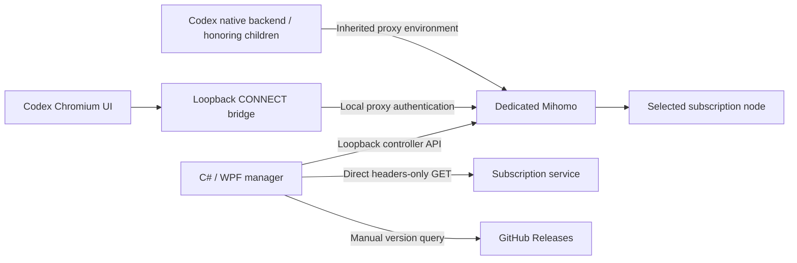

# Architecture

Codex Proxy controls a dedicated Mihomo instance and launches Codex with process-local proxy settings. It does not install a traffic interception driver or enable a system proxy.

## Main components

- **WPF app:** main manager, nonmodal subscription/core settings, tray, language resources, and manually triggered update UI. One instance is kept per Windows user and login session.
- **ProxyService / CoreSession:** own only the processes they start, serialize conflicting service work through the UI's async entry, persist selection, and manage start/stop, reload, or core replacement.
- **DesktopLauncher:** validates the installed desktop executable, refuses to pass new settings to an already running Codex instance, and supplies proxy variables and Chromium flags to the new process.
- **BrowserBridge:** listens only on loopback and adds Mihomo proxy authentication. HTTPS remains a CONNECT tunnel; no TLS interception or root certificate installation occurs.
- **NodeSnapshot:** saves per-subscription node names, protocols, last availability/latency, and test time. Stopped selection is a persisted preference, not a live connection.
- **SubscriptionMetadata:** independently retrieves usage headers with a direct GET, fixed compatibility UA, and no response-body consumption. URL-specific cache contains usage and update time.
- **CodexProbe / TrafficMonitor:** isolated unauthenticated reachability checks and in-memory sampled connection history. Neither is evidence of a successful account/model request.

## Lifecycle

The main proxy starts stopped. Cached previews do not start it. If a node snapshot is missing but a YAML cache exists, a temporary core on separate ports can inspect that cache; stopped testing/import similarly uses isolated temporary cores and cleans them afterward.

Starting the main proxy applies the saved manual/automatic selection. Desktop launch requires a passing node check. Stopping the main proxy retains Codex and its existing bridge so it can reconnect on the saved ports; exiting the manager also disposes the bridge without terminating Codex.

Core replacement retains proxy/controller ports and authentication values. It verifies a candidate before replacing the owned process and attempts to restore the previous configuration/core on failure. The desktop launcher updates its core reference while preserving the bridge endpoint.

Long operations execute outside the UI thread. Conflicting configuration changes are serialized. Codex checks have their own cancellation and generation guards; stale results must not overwrite a new subscription. Changing subscription URL cancels old metadata requests and checks result ownership before updating the UI.

## Data and boundaries

Default state lives at `%LOCALAPPDATA%\codex-proxy`: subscription/profile/core/language settings, credentials, YAML caches, node snapshots, usage cache, extracted bundled core, and raw core log. Directory permissions restrict normal access, but sensitive values are plaintext.

Connection history retains at most 300 entries in memory and samples once per second. Usage is provider-reported and may be delayed; local traffic totals cover the current core process. A hashed cache filename separates subscriptions but does not encrypt their data.

The bridge is a loopback endpoint, not an operating-system process boundary. Other local code under the same user may access local state or connect explicitly to local listeners. Existing global proxy/TUN configuration remains outside this application's control.

See [SECURITY.md](../SECURITY.md) and [TEST-RESULTS.md](../TEST-RESULTS.md) for disclosure and validation limits.
