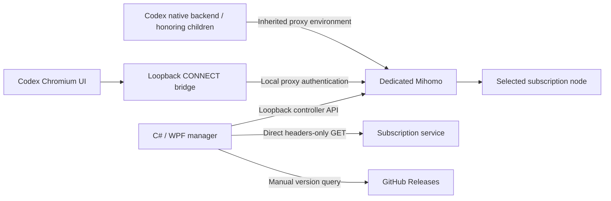

# Architecture

Codex Proxy controls a dedicated Mihomo instance and launches Codex with process-local proxy settings. It does not install a traffic interception driver or enable a system proxy.

## Main components

- **WPF app:** Overview, Nodes, Logs, and Settings pages in one window; nonmodal subscription editor; tray and language resources. Settings hosts General/Core/Updates inline. One instance is kept per Windows user and login session.
- **ProxyService / CoreSession:** own only the processes they start, serialize conflicting service work through the UI's async entry, persist selection, and manage start/stop, reload, or core replacement.
- **DesktopLauncher:** validates the installed desktop executable, refuses to pass new settings to an already running Codex instance, and supplies proxy variables and Chromium flags to the new process.
- **BrowserBridge:** listens only on loopback and adds Mihomo proxy authentication. HTTPS remains a CONNECT tunnel; no TLS interception or root certificate installation occurs.
- **NodeSnapshot:** saves per-subscription node names, protocols, last availability/latency, and test time. Stopped selection is a persisted preference, not a live connection.
- **SubscriptionMetadata:** independently retrieves usage headers with a direct GET, fixed compatibility UA, and no response-body consumption. URL-specific cache contains usage and update time.
- **CodexProbe / TrafficMonitor:** isolated unauthenticated reachability checks and in-memory sampled connection history. Neither is evidence of a successful account/model request.
- **AppUpdate:** GitHub Releases metadata, a public repository manifest fallback, rate-limit retry deadlines, and last-success metadata cache. Source and read time stay distinct from current request status. No updater or GitHub credential storage is included.

## Lifecycle

The main proxy starts stopped. Cached previews do not start it. If a node snapshot is missing but a YAML cache exists, a temporary core on separate ports can inspect that cache; stopped testing/import similarly uses isolated temporary cores and cleans them afterward.

Starting the main proxy applies the saved manual/automatic selection. Desktop launch requires a passing node check. Stopping the main proxy retains Codex and its existing bridge so it can reconnect on the saved ports; exiting the manager also disposes the bridge without terminating Codex.

Disabling Auto pins the core's actual current node without another health test; stopped mode persists the selected/first preview node. Deleting the active subscription stops the owned core, disposes the bridge without terminating Codex, removes the active profile, and leaves other subscriptions inactive. Pending usage/check tasks are cancelled and awaited before deletion, and shared-URL caches remain for other saved entries. Reconfigure and relaunch Codex to apply a new subscription's endpoint/credentials.

Core replacement retains proxy/controller ports and authentication values. It verifies a candidate before replacing the owned process and attempts to restore the previous configuration/core on failure. The desktop launcher updates its core reference while preserving the bridge endpoint.

Long operations execute outside the UI thread. Conflicting configuration changes are serialized. Codex checks have their own cancellation and generation guards; stale results must not overwrite a new subscription. Changing subscription URL cancels old metadata requests and checks result ownership before updating the UI.

Hiding the inline core/update page cancels its scans or queries; a core-apply transaction finishes through the shared service gate. Exiting waits for those tasks before disposing the service. Core scan cancellation reaches extraction/hash work and the bounded version subprocess. State polling defaults to 5 seconds and can be saved as 10/30/60; traffic/log sampling remains once per second.

After a GitHub Release is published, `release-metadata.yml` writes the public `updates/latest.json` on main using the server's ephemeral Actions token. Numeric `vMAJOR.MINOR.PATCH` tags are required; publishing an older version cannot replace a newer manifest. This token is never bundled with the app. Fallback data may be CDN-delayed. The app caches successful metadata for 5 minutes and honors API retry headers even for manual checks.

## Data and boundaries

Default state lives at `%LOCALAPPDATA%\codex-proxy`: subscription/profile/core/language/UI settings, credentials, YAML caches, node snapshots, usage cache, app-update metadata, extracted bundled core, and raw core log. Directory permissions restrict normal access, but sensitive values are plaintext.

Connection history retains at most 300 entries in memory and samples once per second. Usage is provider-reported and may be delayed; local traffic totals cover the current core process. A hashed cache filename separates subscriptions but does not encrypt their data.

The bridge is a loopback endpoint, not an operating-system process boundary. Other local code under the same user may access local state or connect explicitly to local listeners. Existing global proxy/TUN configuration remains outside this application's control.

See [SECURITY.md](../SECURITY.md) and [TEST-RESULTS.md](../TEST-RESULTS.md) for disclosure and validation limits.
